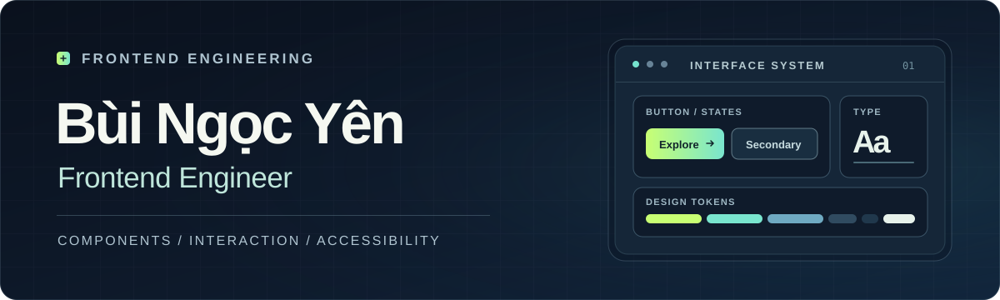

FRONTEND ENGINEERING&nbsp; / &nbsp;INTERFACE CRAFT&nbsp; / &nbsp;BUILT WITH INTENT

# Bùi Ngọc Yên

### Frontend Engineer

I build interfaces that make complex things feel clear. 
My focus is the whole experience: structure, interaction, accessibility, and the details that hold up in everyday use.

[Explore Aperture UI Lab](https://jinjutroy.github.io/aperture-ui-lab/) &nbsp;·&nbsp; [View the source](https://github.com/jinjutroy/aperture-ui-lab) &nbsp;·&nbsp; [Browse repositories](https://github.com/jinjutroy?tab=repositories)

---

## 01 / Selected work

### [Aperture UI Lab](https://github.com/jinjutroy/aperture-ui-lab) · INTERACTIVE UI SYSTEM

An interactive frontend project exploring how a consistent visual language turns individual components into a coherent product experience. Open the live site to explore the interface, then inspect the source to see the decisions behind it.

**Experience:** [Live demo ↗](https://jinjutroy.github.io/aperture-ui-lab/) &nbsp; **Implementation:** [Source code ↗](https://github.com/jinjutroy/aperture-ui-lab)

<table>
  <tr>
    <td valign="top" width="33%"><strong>01&nbsp; / &nbsp;Structure</strong> Clear hierarchy, flexible layouts, and a reusable UI language.</td>
    <td valign="top" width="33%"><strong>02&nbsp; / &nbsp;Interaction</strong> Controls and feedback that help people understand what happened and what comes next.</td>
    <td valign="top" width="33%"><strong>03&nbsp; / &nbsp;Finish</strong> Responsive behavior and thoughtful treatment of the small states that shape the whole experience.</td>
  </tr>
</table>

### [AI Engineering Journey](https://github.com/jinjutroy/ai-engineering-journey) · ENGINEERING STUDY

A public learning lab where I work through AI fundamentals from first principles. It includes tested NumPy implementations of [linear regression](https://github.com/jinjutroy/ai-engineering-journey/blob/main/src/ai_journey/linear_regression.py), [automatic differentiation](https://github.com/jinjutroy/ai-engineering-journey/blob/main/src/ai_journey/autodiff.py), and [scaled dot-product attention](https://github.com/jinjutroy/ai-engineering-journey/blob/main/src/ai_journey/attention.py). The [roadmap](https://github.com/jinjutroy/ai-engineering-journey/blob/main/ROADMAP.md) and [progress log](https://github.com/jinjutroy/ai-engineering-journey/blob/main/PROGRESS.md) show what is complete and what is still in progress.

---

## 02 / How I think about frontend

| Principle | What it means in practice |
| :-- | :-- |
| **Clarity before decoration** | Make the next action, the current state, and the content hierarchy easy to understand. |
| **Interfaces for everyone** | Consider keyboard use, readable contrast, and reduced motion as part of the design. |
| **Systems over one-offs** | Create patterns that stay consistent as a product grows. |
| **Quality in the edges** | Give empty, loading, error, and narrow-screen states the same attention as the ideal path. |

---

THANKS FOR VISITING. THE WORK IS IN THE DETAILS.

